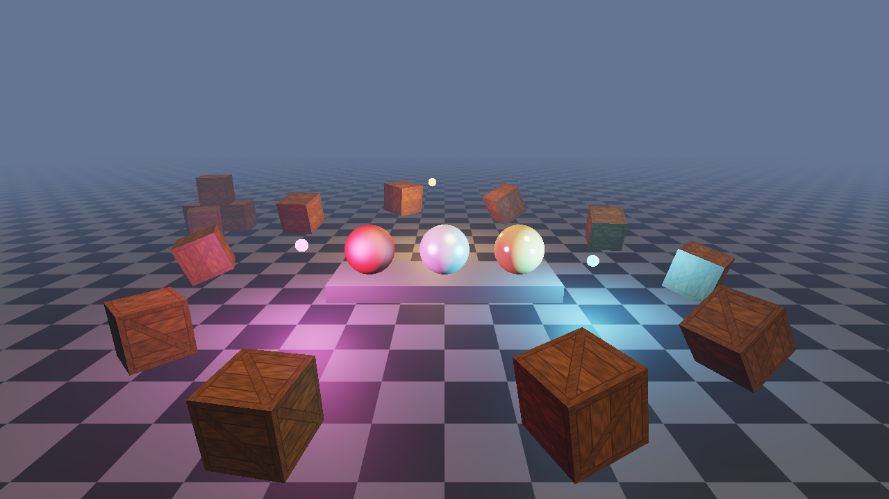

# Kostyl Engine

Маленький 3D-рендерер на C++17 + OpenGL 3.3 core. Не Unreal, зато весь помещается в голову:
~2000 строк своего кода, каждая строка прокомментирована там, где это неочевидно.



## Что умеет

- Окно, ввод, главный цикл с delta time (GLFW)
- Шейдеры из файлов, `#include` в GLSL, **горячая перезагрузка по F5** (сломанный шейдер не роняет программу)
- Текстуры из PNG/JPG (stb_image), sRGB, мипмапы, анизотропная фильтрация, процедурные (шахматка, сплошной цвет)
- Меши: VAO/VBO/EBO, генераторы куба, плоскости, UV-сферы
- Сцена: объекты с Transform (кватернионы) + Material, без ECS-оверинжиниринга
- Освещение Blinn-Phong: направленный свет + до 8 точечных, полусферический эмбиент, экспоненциальный туман
- ACES-тонмаппинг и гамма-коррекция — цвета считаются в линейном пространстве, как положено
- Данные кадра (камера, свет) уходят в GPU одним uniform-буфером (UBO std140) на кадр
- Свободная камера (WASD + мышь), каркасный режим, скриншоты, счётчик fps/draw calls в заголовке
- В Debug-сборке — GL debug output: ошибки OpenGL сразу в консоль, с точным местом
- На Windows exe сам просится на дискретную видеокарту (Nvidia Optimus / AMD)

## Структура

```
kostyl/
├── CMakeLists.txt         зависимости и общие флаги
├── CMakePresets.json      пресеты debug/release
├── engine/                движок (статическая библиотека)
│   ├── include/kostyl/    публичные заголовки (Kostyl.h — всё разом)
│   └── src/
├── sandbox/main.cpp       демо-сцена — смотри её первой
├── assets/
│   ├── shaders/           lit.vert, lit.frag, common.glsl
│   └── textures/
└── external/              glad (сгенерён под GL 3.3 core) и stb — лежат в репе
```

GLFW 3.4 и glm 1.0.1 CMake скачает сам при первой конфигурации (нужен интернет один раз).

## Сборка

### Windows — MSYS2 UCRT64

Открой терминал **MSYS2 UCRT64** (не MSYS и не MINGW64):

```bash
pacman -S --needed mingw-w64-ucrt-x86_64-gcc mingw-w64-ucrt-x86_64-cmake mingw-w64-ucrt-x86_64-ninja

cd kostyl
cmake --preset debug
cmake --build --preset debug
./build/debug/sandbox/sandbox.exe
```

Важно: нужен именно `mingw-w64-ucrt-x86_64-cmake`. Голый `cmake` из MSYS собирает под рантайм MSYS, это не то.
Рантайм линкуется статически, так что `sandbox.exe` можно запускать двойным кликом без DLL рядом.

### Linux — Fedora

```bash
sudo dnf install gcc-c++ cmake ninja-build \
    libX11-devel libXrandr-devel libXinerama-devel libXcursor-devel libXi-devel \
    libxkbcommon-devel wayland-devel wayland-protocols-devel mesa-libGL-devel

cmake --preset debug && cmake --build --preset debug
./build/debug/sandbox/sandbox
```

Void: `xbps-install -S gcc cmake ninja libX11-devel libXrandr-devel libXinerama-devel libXcursor-devel libXi-devel libxkbcommon-devel wayland-devel wayland-protocols MesaLib-devel`

Нет Wayland-пакетов и не хочется — добавь `-DGLFW_BUILD_WAYLAND=OFF`, будет работать через X11/XWayland.

На ноуте с Nvidia в Linux запуск на дискретке:
`__NV_PRIME_RENDER_OFFLOAD=1 __GLX_VENDOR_LIBRARY_NAME=nvidia ./build/debug/sandbox/sandbox`

### Опции CMake

| Опция | По умолчанию | Что делает |
|---|---|---|
| `KOSTYL_WARNINGS_AS_ERRORS` | OFF | `-Werror` для кода движка |
| `KOSTYL_SANITIZE` | OFF | ASan + UBSan (Linux; на MinGW не работает) |

## Управление

| Клавиша | Действие |
|---|---|
| ПКМ (зажать) / Tab | вращать камеру мышью |
| W A S D | полёт |
| E / Space, Q / Ctrl | вверх / вниз |
| Shift | ускорение ×4 |
| Колесо | зум (FOV) |
| P | пауза анимации |
| L | вкл/выкл солнце |
| F1 | каркасный режим |
| F2 | vsync вкл/выкл |
| F5 | перезагрузить шейдеры |
| F12 | скриншот в текущую папку |
| Esc | выход |

Аргументы: `sandbox --novsync`, `sandbox --frames 120 --screenshot shot.png` (отрисовать 120 кадров, сохранить кадр, выйти).

## Как сделать свою сцену

```cpp
#include <kostyl/Kostyl.h>
using namespace kostyl;

class MyGame : public Application {
    FlyCameraController controller;
    Entity* cube = nullptr;

    void onInit() override {
        Material mat;
        mat.albedoMap = Texture::fromFile("textures/crate.png");
        cube = &scene().create("cube", primitives::cube(), mat);

        scene().pointLights.push_back({/*pos*/ {2, 2, 2}, /*color*/ {1, 0.5f, 0.2f}, /*intensity*/ 10, /*range*/ 8});
        camera().position = {0, 1.5f, 4};
        camera().lookAt({0, 0, 0});
    }

    void onUpdate(float dt) override {
        controller.update(camera(), input(), dt);
        cube->transform.rotate(dt, {0, 1, 0});
        if (input().wasKeyPressed(GLFW_KEY_SPACE)) KLOG_INFO("прыг");
    }
};

int main() {
    MyGame game;
    return game.run();
}
```

## Как это работает (кадр изнутри)

1. `Application::run()` — считает `dt`, опрашивает ввод, зовёт твой `onUpdate(dt)`.
2. `Renderer::render()` собирает `FrameData` (матрицы камеры, свет, туман) и одним `glBufferSubData` льёт его в UBO.
   Все шейдеры с `#include "common.glsl"` видят эти данные — не нужно рассовывать uniform'ы по каждой программе.
3. Для каждого объекта: модельная матрица, матрица нормалей (`transpose(inverse(mat3(model)))`), параметры материала,
   текстура в слот 0, `glDrawElements`. Шейдер переключается только когда реально меняется.
4. Фрагментный шейдер: свет в линейном пространстве → туман → ACES → гамма 2.2.
5. `swapBuffers`, раз в полсекунды — fps и статистика в заголовок окна.

Добавил поле в `FrameData` — добавь его и в `common.glsl` **в том же месте**. `static_assert` на размер подстрахует, но не от перестановки полей.

## Отладка

- Debug-сборка включает GL debug output: кривой вызов OpenGL сразу пишет ошибку в консоль.
  Вывод синхронный — поставь брейкпоинт в `glDebugCallback` (Window.cpp) и увидишь виноватую строку в стеке.
- Ошибки шейдеров печатаются с номерами строк; номер файла расшифрован под ошибкой (0 = сам файл, 1+ = include'ы).
- Для покадрового разбора — [RenderDoc](https://renderdoc.org): показывает каждый draw call, буферы, текстуры.

## Куда расти

Примерно по возрастанию сложности:

1. **Загрузка моделей** — OBJ через tinyobjloader или сразу glTF через cgltf.
2. **Dear ImGui** — панель с ползунками для света и материалов, крутить без перекомпиляции.
3. **Тени** — shadow mapping для солнца (framebuffer с depth-текстурой + PCF).
4. **Framebuffer'ы и постпроцесс** — рендер в HDR-текстуру, bloom, тонмаппинг отдельным проходом.
5. **Normal mapping** — тангенты в Vertex, TBN-матрица.
6. **Instancing + frustum culling** — тысячи объектов без тысяч draw call'ов.
7. **PBR** (Cook-Torrance) вместо Blinn-Phong — металл станет похож на металл.

Хороший спутник: [learnopengl.com](https://learnopengl.com) (есть русский перевод на habr — серия «Learn OpenGL»).
